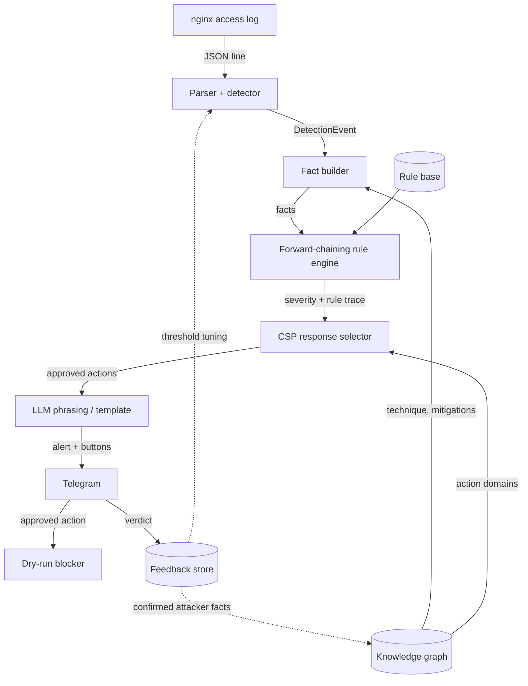

# Knowledge-Driven Cybersecurity Incident Advisor

**The IT Stars**, AINL 3001 Knowledge-driven AI (TU Dublin)

Small organisations run public websites without security staff. Attacks such as SQL injection, brute-force logins and directory scans show up in the web server's logs, but existing tools give technical alerts that non-specialists can't act on.

This system watches an nginx access log and, for each incident, tells the owner in plain English:

1. **what happened**;
2. **how serious it is, and why**;
3. **which safe actions are available**.

Every claim is traceable to an explicit knowledge graph and explicit rules. A person approves every action from Telegram, and actions are only ever dry runs.

The target site is OWASP Juice Shop behind nginx, run locally with Docker Compose. Proposal: [proposal/proposal.md](proposal/proposal.md).

---

## Example output

A directory scan replayed through the system, printed to the console (the same alert goes to Telegram with one button per action):

```
=== ALERT: dir_scan from 10.0.0.70 (medium) ===
What happened: The source IP 10.0.0.70 made 5 directory scanning requests.
How serious:   Severity is medium because it scans sensitive paths.
  [Notify developer]
Why these actions:
  - Notify developer: Directory scanning → OWASP A05:2021 → mitigated by Remove or protect sensitive files
  - Must include an application action (C3: at least one protective action must be offered)
  - Not offered: Block IP (C2: blocking an IP is only offered at high or critical severity; this incident is medium)
(llm)
```

A brute-force attack where a login then succeeded:

```
=== ALERT: brute_force from 10.0.0.60 (critical) ===
What happened: The source IP 10.0.0.60 made 17 login requests against the login page.
How serious:   The severity is critical because a login succeeded right after the failed attempts ...
  [Rate-limit logins] Apply a rate limit to future login attempts.
  [Block IP] Block the IP address 10.0.0.60.
  [Reset password] Reset the password for the compromised account.
Why these actions:
  - Rate-limit logins: Brute-force login → ATT&CK T1110.001 → part of T1110 → mitigated by Limit failed logins
  - Block IP: Brute-force login → ATT&CK T1110.001 → part of T1110 → mitigated by Filter traffic from the attacker
  - Reset password: Brute-force login → ATT&CK T1110.001 → part of T1110 → mitigated by Reset compromised credentials
  - Must include an account action (C4: a login succeeded right after a password-guessing burst, so an account action is required)
(llm)
```

The **"Why these actions"** lines are never written by the LLM. They come straight from the knowledge graph's proof paths and the CSP's constraints:

- "part of T1110" is the graph inheriting the parent technique's mitigations;
- "C2", "C3" and "C4" are the safety constraints that removed or required an action.

The LLM (marked `(llm)`) only words the first two sections, and its answer is checked against the facts. If no LLM key is set, or the check fails, a template is used instead (`(template)`).

---

## System architecture



| Component | Code | AI role |
|---|---|---|
| Log parser, replay | `src/parser.py`, `src/replay.py` | turns nginx JSON lines into records; replays recorded attacks |
| Detector | `src/detection/` | signature rules (SQLi, XSS) and sliding windows (brute force, directory scan) |
| Knowledge graph | `src/knowledge/`, `data/kg/*.csv` | ontology plus triples (MITRE ATT&CK, OWASP); mitigations **derived** by graph rules K1–K4, each with a proof path |
| Rule engine | *being added (Cillian)* | forward chaining over severity and attack-chain rules, with an explanation trace |
| CSP response selector | `src/response/` | chooses a consistent, safe set of actions: backtracking with forward checking, MRV and LCV |
| LLM advisor | `src/advisor.py` | phrasing only; grounding check against the facts; template fallback |
| Telegram bot | `src/telegram_bot.py` | human in the loop: one tap per approved action, dry-run blocking |
| Feedback store, tuning | `src/feedback/` | human verdicts; threshold tuning; confirmed attackers become graph facts |
| Orchestrator | `src/agent/main.py` | runs the pipeline on the live log or a replay |

### AI formulation (AIMA style)

- **State:** working memory of facts about the current incident.
- **Actions:** response options (block IP, rate-limit logins, reset password, notify developer, dismiss).
- **Transition model:** firing a rule adds derived facts; a human decision adds a verdict.
- **Goal test:** an explained severity and a consistent, safe set of recommended actions.
- **Knowledge representation:** a knowledge graph (ontology and triples) and a rule base.
- **Reasoning:** graph rules K1–K4, forward chaining, and constraint satisfaction.

Full formulation, design decisions and evaluation: [docs/report.md](docs/report.md). Module-level documentation: [src/knowledge/README.md](src/knowledge/README.md) and [src/response/README.md](src/response/README.md).

---

## Installation

You need **Python 3.11 or newer**. Docker Desktop is optional, and only needed for the live website.

```bash
git clone https://github.com/matylerb/The-IT-Stars-KDAI-Project.git
cd The-IT-Stars-KDAI-Project
python -m venv .venv
```

Activate the environment:
- Windows: `.venv\Scripts\activate`
- macOS and Linux: `source .venv/bin/activate`

Then install the packages:

```bash
pip install -r requirements.txt
```

### Required packages

The system itself uses **only the Python standard library**: Telegram and Groq are called over HTTP with `urllib`. `requirements.txt` adds:

| Package | Used for |
|---|---|
| `pytest` | the test suite |
| `locust` *(optional)* | only to regenerate the benign traffic dataset (`src/traffic/locust_benign.py`) |

### Optional: Telegram and LLM

Without these, alerts print to the console and use the template wording. To turn them on:

1. Copy `.env.example` to `.env`. `.env` is git-ignored, so never commit it.
2. Fill in your values:
   - `TELEGRAM_BOT_TOKEN`: create a bot with [@BotFather](https://t.me/BotFather).
   - `TELEGRAM_CHAT_ID`: send your bot a message, then open `https://api.telegram.org/bot<token>/getUpdates` and copy `"chat":{"id":...}`.
   - `GROQ_API_KEY`: from [console.groq.com/keys](https://console.groq.com/keys). The default model is `openai/gpt-oss-120b`.
   - `ALLOWLIST`: optional. IPs or ranges that must never be blocked, e.g. `10.0.0.1,192.168.1.0/24`.

The agent reads `.env` by itself.

---

## How to run

Run every command from the repository root.

### 1. Tests

```bash
python -m pytest -q
```

### 2. Replay a recorded attack (no Docker needed)

```bash
python src/replay.py data/brute_force_logs.jsonl --speed 0 | python src/agent/main.py --stdin
```

Other recorded scenarios in `data/`:
- `dir_scan_logs.jsonl`: directory scan;
- `sqlmap_logs.jsonl`: SQL injection;
- `locust_logs.jsonl`: benign traffic, which gives no alerts.

If Telegram is set up, alerts arrive there with buttons. The agent keeps running to answer button taps; press Ctrl+C to stop.

When you tap a button:
- an action button is a dry run (Block IP writes to `data/nginx_deny.dryrun.conf`) and records a `confirmed` verdict;
- the "Ignore" buttons record `false_positive` or `dismissed`;
- a confirmed IP becomes a known attacker in the knowledge graph straight away.

### 3. Live system with Docker

```bash
docker compose up --build
```

This starts Juice Shop behind nginx at http://localhost:8080, with the agent following nginx's access log. Attack it from another terminal:

```bash
python src/attacks/brute_force.py
python src/attacks/dir_scan.py
```

### 4. Individual parts

Set `PYTHONPATH` to `src` first:
- PowerShell: `$env:PYTHONPATH = "src"`
- bash: `export PYTHONPATH=src`

Then:

```bash
python -m knowledge.demo                                              # knowledge graph: mitigations and proof paths
python -m response.selector data/brute_force_logs.jsonl --allow 10.0.0.60   # CSP: allowed actions and pruning trace
python -m evaluate                                                    # detector recall, false-positive rate, latency
python -m evaluate_scenarios                                          # whole-pipeline checks per scenario (needs the rule engine)
python -m feedback.tune_thresholds                                    # threshold tuning from human verdicts
```

---

## Evaluation

Detection on the labelled dataset (968 requests: 719 benign, 249 attack), from `python -m evaluate`:

| Measure | Result | Target |
|---|---|---|
| Recall | 98.4% (245/249) | ≥ 90% |
| False-positive rate | 0.0% (0/719) | ≤ 5% |
| Maximum alert latency | 5.0 s | < 30 s |

The test suite (`tests/`) checks every stage:
- **Parser and detector:** rules and sliding windows.
- **Knowledge graph:** consistency, the K1–K4 rules and proof paths.
- **CSP solver:** checked against brute-force enumeration on 40 random problems for every heuristic combination.
- **Selector:** checked against the real graph, so every offered action has a graph proof.
- **LLM advisor:** the grounding check, with no real LLM calls.
- **Telegram bot:** dry runs, verdicts, refused actions, without calling Telegram.
- **Agent:** a full replay of each scenario.

Scenario results (expected severity, a complete trace, never blocking allowlisted IPs or below high severity, no alerts on benign traffic) are in [docs/report.md](docs/report.md).

---

## Repository layout

```
proposal/proposal.md   project proposal
src/                   source code (see the architecture table above)
data/                  recorded logs, labelled dataset, knowledge graph CSVs
tests/                 pytest suite
docs/report.md         report
presentation/          slides
assets/                screenshots and diagrams
lectures/              KDAI lecture slides and the assignment brief
nginx/                 nginx config (JSON access log format)
docker-compose.yml     Juice Shop + nginx + agent
```

---

## Team contribution

| Student | Primary responsibilities |
|---|---|
| **Ivan Kubsky** | Knowledge representation: ontology, knowledge graph, triple store, graph rules K1–K4 and proof paths, feedback facts |
| **Cillian Chatham** | Reasoning: detection rules and sliding windows, forward-chaining rule engine, rule base, explanation trace |
| **Tyler Brady** | Response and alerting: CSP response selector (solver and heuristics), LLM prompt and grounding check, Telegram alerts, the pipeline orchestrator |
| **Illya Mikava** | Environment and evaluation: Docker environment, attack datasets and labelling, replay, feedback store, threshold tuning, evaluation |

## Use of generative AI tools

As the assignment allows, generative AI tools were used and are acknowledged here. Each member is responsible for, and can explain, their own part.

| Student | AI tools and what they were used for |
|---|---|
| Tyler Brady | Claude (Anthropic) helped design and write the CSP selector, the LLM advisor and grounding check, the Telegram bot and the orchestrator, along with their tests, and helped debug and draft documentation (including this README). Tyler ran and tested all of it. |
| Ivan Kubsky | *to be completed by Ivan* |
| Cillian Chatham | *to be completed by Cillian* |
| Illya Mikava | Claude (Anthropic) helped build the scan-then-SQLi chain scenario generator and the whole-pipeline scenario evaluator, and draft the evaluation sections of the report, reusing the team's existing detector, knowledge graph and CSP. Illya reviewed, ran and tested all of it. |

The running system also uses an LLM (Groq), but only to word alerts, as described above.
