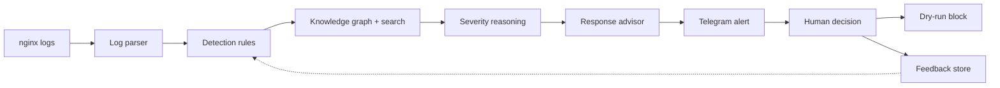

# Proposal: AI Cybersecurity Incident Advisor

## 1. Team information

**Group name:** The IT Stars

| Name | Student number | GitHub username |
| --- | --- | --- |
| Cillian Chatham | C24368226 | [Chats30](https://github.com/Chats30) |
| Tyler Brady | C24394486 | [matylerb](https://github.com/matylerb) |
| Illya Mikava | C24357241 | [IllyaMikava](https://github.com/IllyaMikava) |
| Ivan Kubsky | C24763491 | [1ovann](https://github.com/1ovann) |

## 2. Problem description

Small organisations run public websites but rarely have security staff, so attacks such as SQL injection, credential brute-forcing and directory scanning go unnoticed. Existing tools (web application firewalls, log monitors) produce raw, technical alerts with many false positives. The result is alert fatigue: the responsible person stops reading and a real incident is missed.

**Users:** owners of small business websites and the single IT person who looks after them; secondarily, small development teams without a security function.

**Goal:** for every suspicious event, tell the user (1) what happened, in plain language; (2) how serious it is and why, linked to ATT&CK/OWASP; (3) what to do, as actions approvable with one tap. The agent never acts without approval, and decisions feed back to reduce false positives.

**Key challenges:** accuracy versus alert fatigue; advice grounded in real security knowledge, not hallucinated; safe automation; timely alerts.

## 3. Scope and feasibility

- **In scope:** OWASP Juice Shop behind nginx, run locally with Docker Compose; SQL injection, brute-force login and directory scanning (XSS if time allows); a Telegram bot with action buttons; human-approved IP blocking (dry-run or nginx deny list); our own labelled attack and benign logs.
- **Out of scope:** production traffic, network-layer attacks, DDoS, malware, encrypted traffic, WhatsApp, and any autonomous response.
- **Assumptions:** access logs carry enough signal; sqlmap, Hydra and Gobuster traffic is representative; everyone can run Docker; the APIs stay available.
- **Limitations:** nginx omits POST bodies by default (we enable logging for the login endpoint); rules catch only known patterns (an Isolation Forest anomaly model is a stretch goal); lab results may not transfer to production; LLM wording varies, so it is constrained by retrieval and a fixed format.
- **Risks:** late integration failure (schemas agreed day 3, checkpoints days 8 and 13); invented advice (only knowledge-base mitigations allowed); demo failure (recorded replay); schedule slip (stretch items cut first).
- **Targets:** recall ≥ 90%, false positives ≤ 5%, alert latency < 30 seconds, measured on replayed labelled logs.

## 4. Proposed AI approach

- **Knowledge graph:** ontology of attack patterns, ATT&CK techniques, OWASP categories and mitigations (*mapsTo*, *mitigatedBy*) grounds every alert.
- **Rule-based reasoning:** detection rules turn requests into facts; forward chaining derives severity, with a rule trace.
- **Logic system:** Prolog Horn clauses detect multi-step attacks, e.g. `attack_chain(IP) :- scanning(IP,T1), injection(IP,T2), T2 > T1.`
- **Search:** breadth-first search finds mitigations from a technique and links an IP's events into one incident.
- **Constraint satisfaction:** candidate actions are filtered: never block an allowlisted IP, blocking needs severity High or above, every action must be a graph-linked mitigation.

The LLM only phrases the structured result; it makes no decisions. We do not use adversarial search, as the system reacts to observed events rather than playing against the attacker.

**Example:** 25 failed logins then a success from one IP are rated Critical by forward chaining, linked to earlier scanning by the logic system, mapped to T1110 (Brute Force), and the user is offered Block IP, Reset Password and Rate-limit.

## 5. System design

Logs (live or replayed) are parsed into requests. Detection emits facts, the graph supplies techniques and mitigations, and reasoning sets severity and links incidents. The advisor picks safe actions and writes the alert; the human's decision is executed and fed back into detection thresholds. One Docker Compose file runs Juice Shop, nginx and the agent as separate services.

## 6. Planned contributions

- **Illya Mikava (Data and Environment):** Compose stack, attack and benign traffic scripts, log parser, labelled dataset, replay tool.
- **Cillian Chatham (Detection):** request features, signature rules, threshold tuning, stretch anomaly model.
- **Ivan Kubsky (Knowledge):** ontology, ATT&CK/OWASP graph, graph search, severity rules, logic queries, mitigation corpus.
- **Tyler Brady (AI Integration):** constraint-based response selection, LLM advisor, Telegram bot, feedback store, end-to-end wiring.

**Timeline:** days 1–3 setup and schema contracts; 4–8 core build; 9–13 integration; 14–17 testing and demo. Whole-team checkpoints on days 3, 8, 13 and 17, stand-ups three times a week, and one shared GitHub repository with pull-request review. Everyone tests their own component and writes its report section.
