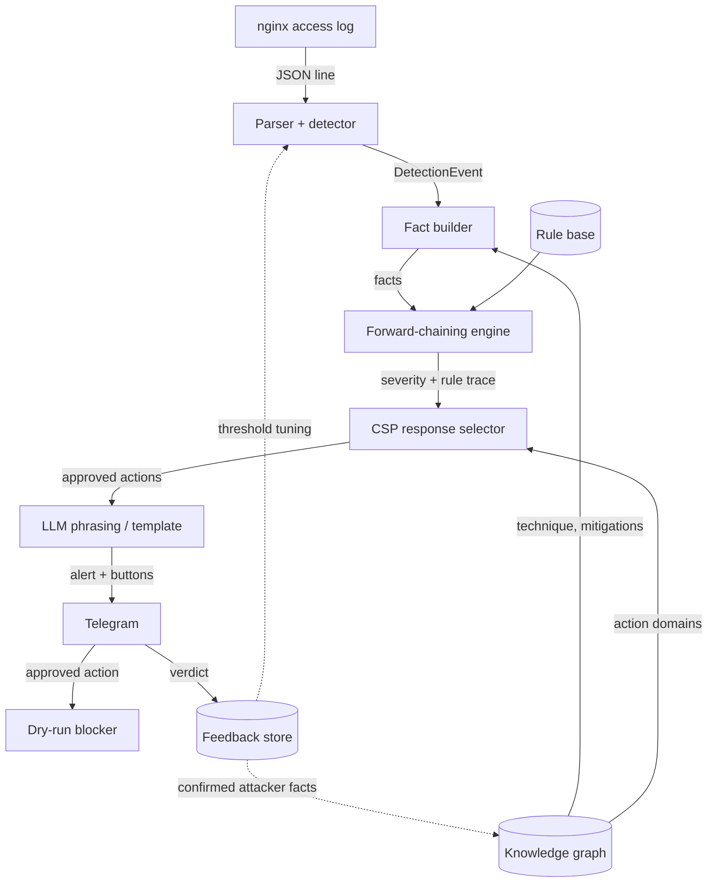

# Proposal (v2): Knowledge-Driven Cybersecurity Incident Advisor

## 1. Team information

**Group name:** The IT Stars

- Cillian Chatham, C24368226, GitHub: Chats30
- Tyler Brady, C24394486, GitHub: matylerb, Tyler-SAP
- Illya Mikava, C24357241, GitHub: IllyaMikava
- Ivan Kubsky, C24763491, GitHub: 1ovann

## 2. Problem description

Small organisations run public websites without security staff. SQL injection, brute-force logins and directory scans appear in web logs, but existing tools give technical alerts non-specialists cannot act on.

Our users are small-business owners and lone IT generalists. For each incident the system explains **what happened**, **how serious it is and why**, and **which safe actions are available**, every claim traceable to explicit knowledge and rules. A human decides.

**Key challenges:** avoiding alert fatigue from noisy, unexplained alerts; grounding advice in real security knowledge rather than invented text; keeping automation safe, with a human approving every action; and explaining the reasoning to non-experts.

## 3. Scope and feasibility

- **In scope:** OWASP Juice Shop behind nginx, run locally with Docker Compose; SQL injection, XSS (query strings only), brute-force login and directory scanning; Telegram alerts with one-tap actions; human-approved, dry-run IP blocking via an nginx deny list.
- **Out of scope:** production traffic, network-layer attacks and DDoS, malware, encrypted traffic, autonomous response and machine-learning models.
- **Feasibility:** the log parser, labelled dataset (968 requests), replay tool and detector are already built and tested (59 passing tests); the detector finds every recorded attack run and flags none of the 719 benign requests. The remaining components are small Python modules joined by agreed JSON schemas, sized for the time left before 30 November.
- **Assumptions:** access logs carry enough signal (nginx does not log request bodies); traffic from our attack scripts and sqlmap is representative; the hosted LLM stays available (a template is used otherwise).
- **Limitations (Lecture 8):** hard thresholds are brittle, rules catch only known patterns, hand-built knowledge faces the acquisition bottleneck, explainable does not mean correct, and lab traffic may not reflect real attacks.
- **Risks:** late integration (mitigated by fixtures and stubs per stage), invented advice (graph-checked output), demo failure (recorded replay fallback).

## 4. Problem formulation

Following Lecture 1's "representation first" approach:
- **State:** working memory of facts about the current incident.
- **Actions:** response options (block IP, rate-limit, reset password, dismiss).
- **Transition model:** firing a rule adds derived facts; a human decision adds a verdict.
- **Goal test:** an explained severity and a consistent, safe set of recommended actions.
- **Knowledge representation:** knowledge graph and rule base.
- **Reasoning:** forward chaining and constraint satisfaction.

## 5. Proposed AI approach

Three module techniques, each answering one question.

**Knowledge graph (Lecture 8) – what is this attack and what mitigates it?** The ontology defines classes `AttackPattern`, `Technique` (ATT&CK), `WeaknessCategory` (OWASP), `Mitigation`, `ResponseAction` and properties `mapsTo`, `classifiedAs`, `mitigatedBy`, `implementedBy`. Individuals are stored as triples in a version-controlled CSV, queried by Python pattern matching:

```
(brute_force, mapsTo, T1110.001)
(T1110.001, mitigatedBy, account_lockout)
(account_lockout, implementedBy, rate_limit_login)
```

Under the open-world assumption, a missing mitigation means "unknown", never invented.

**Rule-based reasoning (Lectures 7–8) – how serious is it?** Following the expert-system architecture, each detector `DetectionEvent` (attack type, source IP, rule IDs, evidence, timestamps) becomes working-memory facts, e.g. `attack(e1, brute_force)`, `success_after_fail(e1)`. Definite clauses are stored as data in a rule base, separate from the inference engine:
- R1: `attack(E, brute_force) ∧ success_after_fail(E) → severity(E, critical)`
- R2: `attack(E1, dir_scan) ∧ attack(E2, sqli) ∧ same_ip(E1, E2) ∧ before(E1, E2) → chain(E2)`
- R3: `chain(E) → severity(E, critical)`

Data-driven forward chaining, suited to monitoring, runs to a fixed point. Conflicting severities resolve to the highest. Recording fired rules gives an explanation facility: a proof trace of *why*.

**Constraint satisfaction (Lecture 5) – what may we do?** Response selection is a CSP (X, D, C):
- X = {network, account, application} response slots;
- D = actions the graph links to the incident's technique, plus `none`;
- C: unary – `network ≠ block_ip` for allowlisted IPs; binary – `block_ip` requires severity ≥ high; global – at least one slot ≠ `none`.

Backtracking with forward checking and MRV finds the solution, offered as one-tap options.

**LLM.** In Lecture 8's hybrid design, the LLM only phrases results: its prompt holds the facts, trace and approved actions and forbids adding others; output is graph-checked, with a template fallback.

**Rejected.** Search: graph lookups are one or two hops, not a search problem. Prolog: replaced by Python forward chaining, as in the labs. Adversarial search: we observe attackers, not play against them. Bayesian networks (Lecture 9): we cannot validate calibrated probabilities on lab data, so detector confidence is shown as-is.

## 6. System design



| Component | Input | Output | AI role |
|---|---|---|---|
| Detector (built) | nginx JSON log line | `DetectionEvent` | signature rules, sliding windows |
| Knowledge graph | attack type, technique | ATT&CK/OWASP mapping, mitigations | knowledge representation |
| Rule engine | working-memory facts | severity, rule trace | forward chaining |
| CSP selector | incident, mitigations, allowlist | approved actions | constraint satisfaction |
| LLM advisor | incident, trace, approved actions | plain-English alert | phrasing only |
| Telegram bot | alert with action buttons | human verdict | human in the loop |
| Feedback store | verdict | threshold changes, new facts | explicit knowledge revision |

**Feedback.** Decisions are stored as `(event_id, rule_ids, verdict)`. A tuning script counts false positives per rule; past a set limit, that threshold rises one bounded step, logged for review. Knowledge is edited explicitly rather than retrained (Lecture 7). Confirmed attackers become graph facts.

## 7. Evaluation

We evaluate explainability on replayed scenarios (brute force, scan, SQL injection, scan-then-injection, benign):
- expected incident and severity per scenario;
- complete trace per alert: evidence → rule → severity → constraint → action;
- every technique and action shown exists in the graph;
- no blocking for allowlisted IPs or below high severity;
- no alerts on benign traffic.

## 8. Planned contributions

Fixed schemas and fixture-based tests per stage mean nobody blocks another member.

- **Ivan:** ontology, knowledge graph, triple store, queries.
- **Cillian:** detection rules, forward-chaining engine, rule base, explanation trace.
- **Tyler:** CSP response selection, LLM prompt, grounding check, Telegram alerts.
- **Illya:** Docker environment, datasets, replay, feedback store, threshold tuning, evaluation.