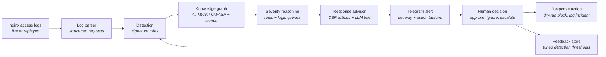

# Proposal: AI Cybersecurity Incident Advisor

We propose a knowledge driven AI agent that detects attacks on a web application, explains them using MITRE ATT&CK and OWASP knowledge, and advises a human through Telegram, who approves any response. A team of four will build and demonstrate it using a local Docker Compose test environment.

## 1. Team information

**Group name:** The IT Stars

| Name | Student number | GitHub username | Role |
| --- | --- | --- | --- |
| Cillian Chatham | C24368226 | [Chats30](https://github.com/Chats30) | Detection Engineer |
| Tyler Brady | C24394486 | [matylerb](https://github.com/matylerb) | AI Integration Engineer |
| Illya Mikava | C24357241 | [IllyaMikava](https://github.com/IllyaMikava) | Data and Environment Engineer |
| Ivan Kubsky | C24763491 | TBC | Knowledge Engineer |

## 2. Problem description

Small organisations run public websites but rarely have security staff, so attacks go unnoticed or alerts go unread.

Web applications face constant automated attacks such as SQL injection, credential brute-forcing and directory scanning. Existing tools like web application firewalls and log monitors produce raw, technical alerts with many false positives. The result is alert fatigue: the person responsible stops reading them, and a real incident is missed.

### Users

- **Primary:** owners of small business websites, and the single IT person who looks after them.
- **Secondary:** small development teams without a dedicated security function.

### Goals

For every suspicious event, the system should tell the user:

1. What happened, in plain language.
2. How serious it is, and why, linked to an authoritative attack framework.
3. What to do, as recommended actions the user can approve with one tap.

The human stays in control: the agent never takes a response action without approval, and the user's decisions feed back into the system to reduce false positives.

### Key challenges

- **Accuracy vs. alert fatigue:** catching real attacks without flooding the user with false positives.
- **Trustworthy explanation:** generating plain-language advice that is grounded in real security knowledge, not hallucinated.
- **Safe automation:** responding quickly while never blocking legitimate users without human approval.
- **Timeliness:** delivering an alert while it can still be acted on.

**Relevance to Knowledge Driven AI.** The core of the system is explicit knowledge: an ontology of attacks, techniques and mitigations built on MITRE ATT&CK and the OWASP Top 10, reasoned over with rules, a logic system, search and constraint satisfaction. A large language model only phrases the results; it doesn't make the decisions.

## 3. Scope and feasibility

| Area | In scope | Out of scope |
| --- | --- | --- |
| Target | OWASP Juice Shop behind nginx, run locally with Docker Compose | Production websites and live user traffic |
| Attacks | SQL injection, brute-force login, directory scanning; XSS if time allows | Network-layer attacks, DDoS, malware, encrypted traffic inspection |
| Alerts | Telegram bot with inline action buttons | WhatsApp (needs Meta business verification and approved templates) |
| Response | Human-approved IP block, run in dry-run mode or via an nginx deny list | Any autonomous response without approval |
| Data | Our own labelled attack and benign traffic logs | Large-scale real-world traffic; CSIC 2010 benchmark is a stretch goal |

### Assumptions

- Web server access logs (method, URL and query, status, client IP, user agent, timing) carry enough signal to detect the target attacks.
- Traffic generated with standard tools (sqlmap, Hydra, Gobuster) is representative of real automated attacks.
- An LLM API and the Telegram Bot API are available to the team throughout the project.
- Every team member can run Docker on their laptop.

### Limitations

- nginx does not log request bodies by default, so attacks hidden in POST bodies are invisible unless body logging is enabled. We will test with query-string payloads and enable body logging for the login endpoint.
- Rule-based detection only catches known patterns; novel attacks depend on the stretch anomaly model.
- Results come from a lab environment with synthetic traffic and may not transfer directly to production.
- LLM wording varies between runs. We constrain it with retrieval and a fixed output structure, but advice quality is rated, not guaranteed.
- A real deployment behind Cloudflare would need the real client IP read from the `CF-Connecting-IP` header and blocks applied through the Cloudflare API. This is described as future work, not built.

### Risks and mitigations

| Risk | Mitigation |
| --- | --- |
| Components don't fit together late in the project | Data schemas agreed as contracts on day 3; integration checkpoints on days 8 and 13 |
| The LLM gives wrong or invented advice | Advice is retrieved from the knowledge base, and the prompt only allows mitigations found there |
| The live demo fails | A recorded attack run is replayed through the pipeline as a fallback |
| The schedule slips | Stretch items are cut first, in a fixed order |

## 4. Proposed AI approach

The approach uses five techniques from the module: a knowledge graph holds the security knowledge, rules and a logic system reason over it, search finds what is relevant, and constraint satisfaction chooses safe responses.

| Technique | How we use it | Why it fits the problem |
| --- | --- | --- |
| Knowledge graph | An ontology of attack patterns, ATT&CK techniques, OWASP categories, impacts and mitigations, linked by relations such as *mapsTo* and *mitigatedBy*, built from MITRE ATT&CK and the OWASP Top 10 | Security knowledge is a network of linked concepts; the graph is an authoritative, inspectable source that grounds every alert |
| Rule-based reasoning | Detection rules turn requests into facts (e.g. IF the query string contains a SQL tautology THEN `sqli_attempt`); a forward-chaining production system then derives severity from those facts | Fast, transparent and auditable; needs no training data, and every conclusion has a rule trace |
| Logic system | Facts and rules held as Horn clauses (e.g. Prolog via pyswip) and queried by backward chaining, such as `attack_chain(IP) :- scanning(IP,T1), injection(IP,T2), T2 > T1.` | Detects multi-step attacks declaratively, and the proof of each query is the explanation |
| Search | Breadth-first search over the knowledge graph from a detected technique to its mitigations and affected assets, and across an IP's events to link them into one incident | Finds the most relevant mitigations, and stops one incident becoming many separate alerts |
| Constraint satisfaction | Chooses which responses to recommend. Variables are candidate actions; constraints include: never block an allowlisted IP, blocking requires severity High or above, and every action must be a mitigation linked in the graph | Guarantees every recommended action is safe and valid before a human sees it |

**Supporting components.** A retrieval-augmented LLM turns the structured result (facts, rule trace, chosen actions) into a plain-English alert; it adds no conclusions of its own. An Isolation Forest anomaly model is a stretch goal for unusual requests that no rule matches. We don't use adversarial search: the system reacts to observed events rather than planning moves in a game against the attacker.

### Worked example: a brute-force login, step by step

1. **Rules (detection):** 25 failed `POST /rest/user/login` requests from one IP in 60 seconds, then a successful login, become the facts `brute_force(203.0.113.7)` and `successful_login(203.0.113.7)`.
2. **Rules (severity):** forward chaining fires *brute_force AND successful_login → Critical*.
3. **Logic system:** the query `attack_chain(203.0.113.7)` succeeds because the same IP scanned the site minutes earlier, so both events join one incident.
4. **Knowledge graph and search:** the event maps to ATT&CK T1110 (Brute Force); search returns its linked mitigations: block the source, reset the account password, rate-limit the endpoint.
5. **Constraint satisfaction:** all three actions pass the constraints (the IP isn't allowlisted and severity is Critical), so all are recommended.
6. **LLM and human:** the advisor writes the alert below; the user taps *Block IP* and the decision is logged.

```text
🔴 CRITICAL – Possible account takeover
What happened: 25 failed logins to /rest/user/login from 203.0.113.7 in 60 s, then a successful login.
Why it matters: matches MITRE ATT&CK T1110 Brute Force; a successful login suggests the password was guessed.
Recommended: 1) Block 203.0.113.7  2) Reset the affected account's password  3) Add rate limiting to /login
[Block IP]  [Ignore]  [Escalate]
```

## 5. System design

The system is a pipeline: logs pass through detection, knowledge lookup and severity reasoning before the response advisor chooses safe actions and writes an alert. A human approves any response, and their decisions feed back into detection.



Every conclusion comes from the knowledge graph, rules, logic queries and constraint solver; the LLM only phrases them.

| Component | Input | Output | AI technique |
| --- | --- | --- | --- |
| Log parser | nginx access log lines, live or replayed | Structured request records (JSON) | — |
| Detection | Request records | Facts: attack type, client IP, evidence | Rule-based reasoning; anomaly model |
| Knowledge graph | Facts | ATT&CK technique, OWASP category, impacts, mitigations | Knowledge graph and graph search |
| Severity reasoning | Facts, graph data, recent history for the IP | Severity, linked incident, rule and proof trace | Forward-chaining rules and logic queries |
| Response advisor | Severity, candidate mitigations, allowlist | Safe action set and a plain-English alert | Constraint satisfaction; retrieval-augmented LLM |
| Telegram bot | Alert | Message with Block / Ignore / Escalate buttons | — |
| Response and feedback | Human decision | Dry-run block or nginx deny-list entry; feedback log | Human in the loop |

**Inputs:** web server access logs, the MITRE ATT&CK and OWASP knowledge base, and human decisions.

**Outputs:** Telegram alerts with severity and advice, executed (dry-run) responses, and an incident and feedback log.

**Deployment:** one Docker Compose file runs Juice Shop, nginx and the agent (pipeline plus Telegram bot) as separate services, with logs shared through a volume.

## 6. Testing and evaluation

All testing runs locally on Docker Compose, so every team member can reproduce every result with `docker compose up`, and no live system is attacked.

### Environment

- **Live mode:** Juice Shop and nginx run as Compose services; attack scripts (sqlmap, Hydra, Gobuster) run from the same laptop against `localhost`, while Locust generates normal user traffic.
- **Replay mode:** a script streams a recorded, labelled log through the pipeline line by line. Every run is identical, so metrics are reproducible, and a recorded run is the fallback if the live demo fails.
- **Ground truth:** every attack run is logged with its time, tool and target, which labels the dataset.

### Metrics and targets

| Metric | How it's measured | Target |
| --- | --- | --- |
| Detection recall | Share of labelled attacks that raise an alert, per attack type | ≥ 90% |
| False positive rate | Share of benign requests that raise an alert | ≤ 5% |
| Technique mapping accuracy | Alerts mapped to the correct ATT&CK technique | 100% on the test set |
| Alert latency | Time from the attack request to the Telegram message | < 30 seconds |
| Advice quality | Team members rate a sample of alerts for correctness and clarity | ≥ 4 out of 5 average |
| Response correctness | The approved block is applied in dry-run mode, and a repeated attack is flagged as blocked | All test cases pass |

The targets are our own goals for a lab setting; we will report the measured values whether or not they are met.

## 7. Planned contributions

Each of the four team members owns one layer of the pipeline from start to finish, and everyone shares testing and the report.

| Role | Owner | Responsibilities | Key deliverables |
| --- | --- | --- | --- |
| Environment and Data | Illya Mikava | Docker Compose stack, attack and benign traffic scripts, log parser, replay script | Compose stack, labelled dataset, replay tool, demo fallback recording |
| Detection | Cillian Chatham | Request features, signature rules, stretch anomaly model, threshold tuning | Rule detector emitting events; precision, recall and false positive results |
| Knowledge Engineering | Ivan Kubsky | Ontology design, ATT&CK/OWASP knowledge graph, graph search, severity rules and logic queries, query API | Populated graph, severity rules, logic queries for attack chains, RAG corpus of mitigations |
| Agent and Integration | Tyler Brady | Constraint-based response selection, RAG advisor, Telegram bot, feedback store, end-to-end wiring | Working alerts with action buttons; integrated demo |

### Timeline

| Role | Days 1–3: Setup and design | Days 4–8: Core build | Days 9–13: Integration | Days 14–17: Test and demo |
| --- | --- | --- | --- | --- |
| Environment and Data | Compose stack, log schema | Attack scripts, labelled dataset | Replay script, ground-truth log | Replay evaluation, demo fallback |
| Detection | Features, rules, event schema | Rule detector v1 (stretch: anomaly model) | Tune thresholds, wire to graph | Precision and recall, results section |
| Knowledge Engineering | Ontology design, ATT&CK mapping | Populate graph, severity rules | Query API, RAG corpus | Check mappings, reasoning traces |
| Agent and Integration | Telegram bot, shared repo | RAG advisor v1, alert buttons | End-to-end wiring, dry-run blocking | Alert latency, demo rehearsal |
| **Checkpoint** | **Day 3:** contracts agreed | **Day 8:** components v1 | **Day 13:** end to end | **Day 17:** demo and report |

The four roles work in parallel and integrate at a whole team checkpoint at the end of each phase.

### Ways of working

- **Contracts first:** the log, event and knowledge query schemas are agreed on day 3, so each role can build against them in parallel.
- **Checkpoints:** whole team integration tests on days 3, 8, 13 and 17.
- **Short stand ups** three times a week, and one shared GitHub repository with pull-request review.
- **Shared work:** every member tests their own component and writes the report section for it.

## References

- [MITRE ATT&CK](https://attack.mitre.org/)
- [OWASP Top 10](https://owasp.org/www-project-top-ten/)
- [OWASP Juice Shop](https://owasp.org/www-project-juice-shop/)
- [OWASP ModSecurity Core Rule Set](https://coreruleset.org/)
- [Telegram Bot API](https://core.telegram.org/bots/api)
- [Docker Compose](https://docs.docker.com/compose/)
